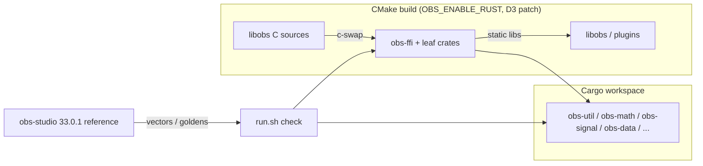

# Architecture — obs-rust (Rust rewrite)

A C/C++ codebase (obs-studio, reference pin **33.0.1**) being replaced in place by a Rust
Cargo workspace in the same repo: Rust and C coexist in one build (T1) behind the CMake
option `OBS_ENABLE_RUST` — currently an in-repo patch file applied by CI/nightly (D3,
decided 2026-11-23) — until Phase 7 retires the C sources. The C plugin ABI is the stable
compat layer throughout (T2). Decisions are recorded in [adr/](adr/); principles in
[tenets.md](tenets.md); work in [epics.md](epics.md).

## Planes

- **Leaf crates** (`crates/`): `obs-util`, `obs-util-small`, `obs-math`, `obs-signal`,
  `obs-data`, `obs-properties`, the lexers — ports of `libobs/util` & friends (Phase 1,
  [epics 1–8](epics/)). Each port keeps the C layout byte-compatible where C callers touch
  it (T5, ADR 0005 Amendment 1) and is proven by conformance vectors (T4, T11).
- **C ABI surface** (`crates/obs-ffi`): `#[no_mangle] extern "C"` shims + generated headers
  (cbindgen, WP-31). Builds with the `c-swap` feature so CMake can link Rust statics into
  `libobs`; C callers switch file by file (T1).
- **Conformance harness** (`test/conformance/`): the C reference (33.0.1) + `run.sh`
  (`check` for vectors, `c-swap` for the swapped build) + golden dumps. This is the
  definition of "done" (T3, T4, T11).
- **Future planes** (phases 2–7): media pipeline, wgpu graphics (T8), core object model,
  41 plugins (T9 for vendor SDKs), cxx-qt frontend — see [epics.md](epics.md) milestones.

## How a C module becomes Rust (the recipe)

1. Clean-room spec (S-xxx) is the source of truth (T3).
1. Port lands in the target crate with conformance vectors from the 33.0.1 reference (T11).
1. `obs-ffi` shims expose the C entry points; the CMake swap set gains the file (D3).
1. One WP = one branch + one PR; subtask tick and ODD entry in the same PR (T4).

## Cross-cutting

- **Config:** CMake option `OBS_ENABLE_RUST` (patch, D3); crate features `c-swap`,
  `no-miri-gate` (filesystem-dependent goldens).
- **Secrets:** none in repo, logs or artifacts (no secrets needed; CI uses the bot token
  from the GitHub App installation).
- **Logging / observability:** `blog`/base log for C-side output; Rust-side logging follows
  the crate convention; ODD log (`odd/tasks/`) tracks what shipped and what was skipped.
- **Build/CI** — the checks every code PR must pass (`.github/workflows/rust.yml`).
  Docs-only changes (`docs/**`, `odd/**`, `*.md`) run only the markdown format
  check (`mdformat --check .`, `.github/workflows/markdown.yml`) instead:
  1. `cargo fmt --all --check`
  1. `cargo clippy --workspace --all-targets -- -D warnings` (incl. `undocumented_unsafe_blocks`, T5)
  1. `cargo nextest run --workspace`
  1. `cargo deny check` (T10) + `cargo audit`
  1. Miri on pure crates (`obs-util`/`obs-math`/`obs-signal`, `--features no-miri-gate`)
  1. Conformance `check` (26 CI areas, 33.0.1 reference, T11) + `c-swap` lint
- **Docs:** [epics.md](epics.md) (what gets built), [decisions-open.md](decisions-open.md)
  (what is undecided), [adr/](adr/) (why), [rust-rewrite/](rust-rewrite/README.md)
  (specs, phases, subtasks), [docs/tests/](tests/) (test matrices).
